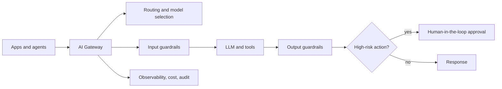

# AI Gateways & Guardrails — a product manager's teardown

*The trust layer for agentic products, from the product seat: what each piece does, and the decision behind it.*

When one app calls one model, you don't need much between them. When an organization runs many apps against many models and tools — and especially when those models start **taking actions** — you need a control plane in the middle. That's the **AI gateway**, and its hardest, most product-defining part is **guardrails and evaluation**: the difference between "the demo worked" and "we can put this in front of customers in a regulated domain."

I've built this layer in practice — agentic, MCP-based systems with guardrails and full audit traceability for real-time patient interventions in regulated healthcare. This is how I think about it.

## What an AI gateway is

A single control point between your applications and the models, tools, and data they use. Apps talk to the gateway; the gateway handles routing, safety, cost, and observability — and, for agents, authorization and human-in-the-loop — before anything reaches a model or takes an action.

## The components — and the product decision behind each

**Routing and model selection.** Pick the model per request: the expensive frontier model, a cheaper fine-tuned one, or a cached answer. *The decision:* the cost–quality–latency triangle. Low-stakes feature, route cheap; high-stakes one, quality wins and you eat the cost. The PM owns where that line sits, per use case.

**Caching.** Reuse answers for repeated or similar queries. *The decision:* cost and latency vs. freshness and correctness — safe for stable knowledge, risky for anything time- or context-sensitive.

**Rate limits and quotas.** Protect reliability and cost; stop abuse. *The decision:* per-tenant fairness and your unit economics.

**Input guardrails.** Handle sensitive data (redact/minimize PII/PHI), detect prompt-injection, and — critically — run red-flag detection *before* the model: in a health context an emergency routes to a human, never to the LLM. *The decision:* what must never reach the model, and what must escalate instead.

**Output guardrails.** A safety classifier, a scope check ("is this within what we're allowed to advise?"), and enforced grounding — the answer cites its source or it abstains. *The decision:* in regulated domains an answer without a source is a liability, so you tune toward "abstain and escalate" over "guess."

**Evaluation.** You can't ship clinical or financial AI on vibes. An eval harness runs the model against curated and adversarial test sets, graded by rules, an LLM-judge, and human review. *The decision:* track **safety** metrics, not just accuracy — and the one that matters most is often **recall on the dangerous cases** (missing an emergency is far worse than a false alarm). A release gate blocks any launch that regresses it.

**Observability and cost.** Tokens, latency, traces, spend per tenant and per feature. *The decision:* define what "good" and "too expensive" look like, measurable in production.

**Tool-calling, MCP and human-in-the-loop.** When the model can *act* (issue a refund, change a record, renew a prescription), the gateway checks scoped authorization and gates high-risk actions to a human. *The decision:* which actions may be autonomous vs. must be approved — the line between useful autonomy and dangerous "excessive agency."

**Audit and provability.** Every decision — and every *refusal* — emits a structured, tamper-evident record: inputs (hashed, not raw PII), model version, what was retrieved, which guardrails fired, the action taken or refused, and whether a human was involved. *The decision:* treat "prove what the system did" as a product feature, not an afterthought. In regulated settings it's the license to operate.

## What actually matters (the PM's view)

- **The asymmetry.** A false negative (missing a dangerous case) can harm someone; a false positive costs money and friction. In high-stakes domains you deliberately tune toward over-escalation — and you say so out loud.
- **The triangle.** Safety, cost, and latency trade against each other. There's no universal right answer; there's the right answer *for this use case at this risk level*, and owning that call is the job.
- **Build vs. buy.** Gateways like Kong, Portkey, TrueFoundry and Traefik Hub exist for a reason — most teams shouldn't build this from scratch. The product question is which guarantees you own yourself: usually your guardrail policies, your eval gates, and your audit trail.

---

*Why I wrote this:* I've built agentic, guardrailed, fully-audited AI in a regulated domain, and I'm going deeper on the infrastructure it runs on. These are my own views, synthesized from that work and ongoing study. The principle behind all of it — **verify before you claim, and describe things at true magnitude** — is exactly what guardrails and evaluation enforce for a machine.
