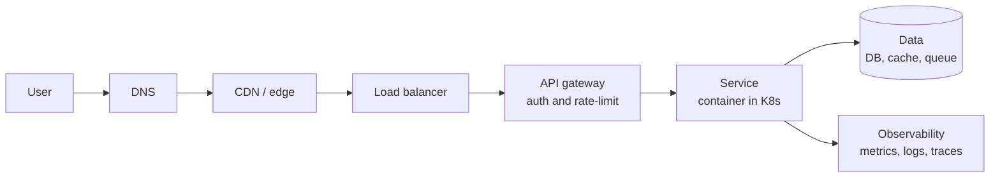

# Cloud-Native for Product Leaders

*How the modern stack fits together — with the product decision behind each layer. Written from the product seat, for PMs who want real depth instead of hand-waving.*

A product leader doesn't need to configure Kubernetes. But to own a platform product — to make credible tradeoffs, earn engineering's trust, and understand why "works in one region" is not "works in twenty" — you need a real map of the stack your product runs on. This is that map.

## A request's journey

## The layers — and the product decision behind each

**DNS + TLS.** How a user's browser finds your servers and opens a secure (encrypted, trusted) connection. *The decision:* certificates and trust are table stakes — the product question is where you terminate TLS and how you handle it at scale.

**CDN / edge.** Cache and serve content from locations physically close to users. *The decision:* latency and cost — what you push to the edge vs. compute fresh every time.

**Load balancing + API gateway.** Spread traffic across instances, and run the "front door" policy: authentication, rate limiting, routing, versioning. *The decision:* what rules live at the edge of your system vs. inside each service.

**Compute: containers + Kubernetes.** Containers make an app portable ("runs the same everywhere"); Kubernetes orchestrates them — scheduling, scaling, self-healing via a constant reconciliation loop toward a desired state. *The decision:* managed (EKS/GKE) vs. self-run, and how much orchestration complexity is worth it for your stage.

**Ingress / Gateway API.** How traffic from outside reaches services *inside* the cluster, through a controller (Traefik, Envoy, nginx) and a routing model. *The decision:* which controller, and the routing/TLS model your teams standardize on.

**Data layer.** Databases, caches, and queues. State is the genuinely hard part of any system. *The decision:* consistency vs. availability vs. cost, and single-tenant vs. shared — choices that shape reliability and unit economics for years.

**Observability.** Metrics, logs, and traces, rolled into SLOs. You can't run — or sell the reliability of — what you can't see. *The decision:* what "healthy" means, defined as numbers you hold teams to.

**Scale & reliability.** Autoscaling, multi-region, and the failure modes that only appear at scale. *The decision:* the cost of nines — each extra "9" of uptime is real money and complexity, so you buy only what the business needs.

**Security.** Zero-trust, mTLS between services, secrets management, RBAC, network policies. *The decision:* least privilege by default, and which controls become product features for enterprise buyers (the ones that pass a security review and close the deal).

## What actually matters (the PM's view)

- **Build vs. buy.** Most teams shouldn't build gateways, data planes, or observability from scratch. The product question is which guarantees you must own yourself.
- **The real tradeoff triangle:** velocity, reliability, and cost. You're always spending one to buy another; naming which, deliberately, is the job.
- **Complexity lives in state and scale, not the happy path.** The demo always works. The product decisions are about the 1% — the failures, the twentieth region, the enterprise security review.

---

*Why I wrote this:* I've led platform and data products for 12+ years and I'm going deeper on the cloud-native layer they run on. These are my own notes, synthesized from that work and ongoing study. The principle behind all of it: **verify before you claim, and describe things at true magnitude.**
